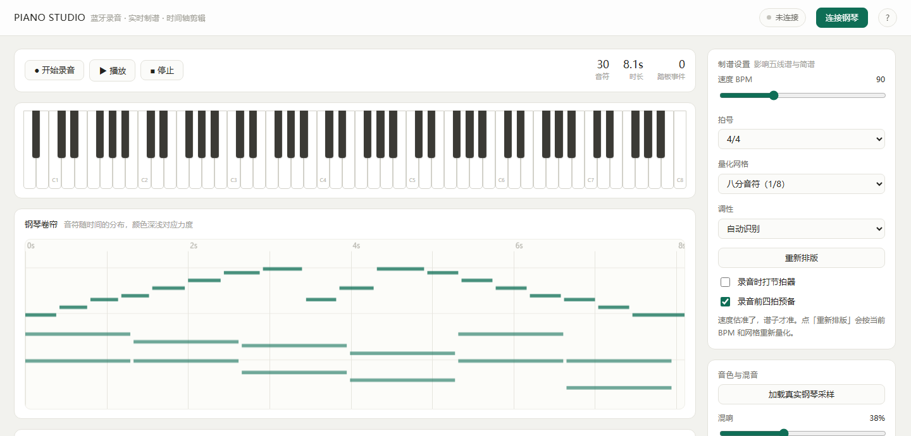

# PIANO STUDIO

**A workstation for digital pianos — from keystroke to finished track.**

Connect over Web Bluetooth (BLE-MIDI) and watch staff and numbered notation appear as you play.
Built in: practice center, standard MIDI import, multi-clip timeline editor, microphone/line input.
Export MIDI / WAV / MP3, or the score as PNG / PDF. Runs as a web page, or as a Windows app
with in-app auto-update.

No audio interface · No recording cable · No install · Works offline · Data never leaves your machine


Current version: **v1.9.1**. See [CHANGELOG.md](CHANGELOG.md) for the full release history.

> 中文文档见 [README.md](README.md)



---

## Why this exists

Recording a digital piano normally means crossing three hurdles. This project removes all three.

### 1. Recording costs money and adds noise

A digital piano has no audio file. Pressing a key makes the sound engine compute a
waveform, a DAC turns it into analogue voltage, and an amplifier drives the speakers.
The classic route is `Line Out → cable → audio interface → USB → DAW`, which brings
overpriced "piano recording cables", level mismatch, clipping, ground-loop hum, and
noise you cannot remove afterwards.

**This project takes another route.** Most affordable digital pianos expose
**BLE-MIDI** — Bluetooth Low Energy MIDI. It carries *events* (which key, how hard,
when released), not sound. The browser receives those events and synthesises the
audio locally. There is no analogue stage, therefore **no noise floor, no clipping,
no ground loop**.

### 2. Sheet music means copying notes by hand

After recording, you either transcribe by hand or click notes into notation software.
Here the score appears automatically: **standard notation** (grand staff, key signature,
time signature, beaming, rests) and **numbered notation** (jianpu).

### 3. Editing means installing a DAW

You always need to trim, cut a wrong bar, join three takes, fade out. The built-in
editor uses a **multi-clip timeline**: one cut produces two independent clips you can
drag, trim, reorder, with undo/redo, normalisation and de-click fades.

| | Traditional | PIANO STUDIO |
|---|---|---|
| Hardware cost | cable + interface ¥50–300 | **¥0** |
| Quality limit | noise floor, clipping | lossless digital events |
| Mistakes | play it again | edit the data |
| Score | manual transcription | auto-generated |
| Editing | another app | built in |
| Privacy | cloud upload | **stays local** |

---

## Features

### Recording
- BLE-MIDI over GATT — bypasses OS pairing, so a device hidden from the Windows
  "Add a device" dialog still connects
- USB-MIDI through the Web MIDI API, with port discovery and hot-plug monitoring
- Captures note on/off and velocity; 88-key on-screen keyboard highlights live
- Metronome with accented downbeat, plus a 4-beat count-in
- Sustain (CC) monitor — tells you whether your piano actually broadcasts pedal data

### Notation
- Standard notation via VexFlow: clefs, auto key signature, time signature, stem
  directions, beamed eighths, filled-in rests
- Numbered notation (jianpu): scale degrees, octave dots, beam underlines, barlines,
  with both hands shown on separate rows
- Automatic grand staff split at C4
- Key detection using Krumhansl–Kessler major and minor profiles
- Cross-bar ties for long notes, rendered in VexFlow and jianpu
- Time signatures 4/4, 3/4, 2/4, 6/8
- Live re-layout every 600 ms while recording; BPM re-estimated every 2.5 s
- Piano-roll editing: select, move, resize, transpose, quantise, change velocity,
  delete, undo and redo (50 note-edit levels)

### Rendering & export
- 44 local FluidR3_GM piano samples (A0–C8, every semitone), fully offline
- Real-time convolution reverb, bus limiter
- Export **MIDI**, **WAV** (44.1 kHz / 16 bit), **MP3** (128 kbps, encoded in-browser)
- Import standard MIDI files, select one or more tracks, and export staff or numbered notation as PNG or printable PDF with a title and author
The top workspace switcher separates performance, notation, editing and project management, so the full app does not have to be used as one long scrolling page.
The performance workspace can also record a microphone or line input, show live levels and clipping, load the take into the editor, and apply a millisecond latency offset.

### Timeline editor
- Multi-clip model: split, drag, trim both ends, delete, leave gaps and overlap
- Selection: delete, keep, copy, paste, silence, reverse, normalise, fade in/out,
  trim leading/trailing silence
- Wheel zoom anchored at the cursor, time ruler, overview strip, draggable playhead
- 0.05 s snapping (hold Alt to disable), zero-crossing alignment
- 8 / 30 / 80 ms de-click fades at clip boundaries
- Automatic crossfades for overlapping clips
- Drop an audio file anywhere on the page to import it

### Project management
- Autosave to IndexedDB 1.2 s after every edit, plus a save on page hide
- Restore prompt on the next visit
- Export/import a `.json` project (audio + full edit state)
- Save, restore and delete up to 20 local project snapshots

---

## Quick start

**Windows desktop app (recommended)** — download `PianoStudio-Setup-x.y.z.exe`
(installer) or `PianoStudio-Portable-x.y.z.exe` (no install needed) from the
[latest release](https://github.com/SYH-y/piano-studio/releases/latest). It ships
its own Chromium, so no Python and no browser are required; Bluetooth works out
of the box. The binaries are unsigned, so SmartScreen may ask you to choose
"More info → Run anyway".

**Web version (Windows)** — install [Python 3](https://www.python.org/downloads/) (check
`Add python.exe to PATH`), then double-click **`start.bat`**.

**macOS / Linux**

```bash
./start.sh
# or
python3 serve.py
```

Then open the printed `http://localhost:8765/` in **Chrome or Edge**.

### Why not just double-click index.html?

Web Bluetooth is a **secure-context** API: it only works on `https://` or
`http://localhost`. Under `file://` the browser refuses outright — not even the
device picker appears. `serve.py` is a tiny local static server that exists purely
to satisfy that requirement. It binds to `127.0.0.1` only and makes no outbound
requests.

| Browser | Status |
|---|---|
| Chrome / Edge 89+ (desktop) | ✅ full support |
| Chrome for Android | ⚠️ Bluetooth works; narrow layout is adapted, while complex editing is better in landscape or on desktop |
| Firefox | ❌ no Web Bluetooth |
| Safari | ❌ no Web Bluetooth |

### Try it without a piano

Open `index.html?demo=1` to load a short demo performance (right-hand scale,
left-hand chords) so every view has content.

---

## Does your piano work?

This only supports **standard BLE-MIDI** devices. The reliable check is to scan BLE
advertisements for the service UUID:

```
03b80e5a-ede8-4b33-a751-6ce34ec4c700
```

If your piano advertises it, you are good. If it does not, you can still use the
editor: record through a cable + audio interface, then drag the file in.

> Common trap: a **USB-A** port on the piano (labelled `USB` / `U DISK`) is a *host*
> port for flash drives and can never talk to a PC. Only a square USB-B port
> (`USB TO HOST`) or Bluetooth can. Two host ports connected together will never
> enumerate.

---

## How it works

**Bluetooth** — `navigator.bluetooth.requestDevice()` filtered by the BLE-MIDI
service, then `gatt.connect()` and `startNotifications()` on characteristic
`7772e5db-…-f2669d106bf3`.

**Packet decoding** — a notification packs `[header | ts high 6 bits]`, then one
`[ts low 7 bits][status][data…]` group per message. Timestamp octets (`0x80–0xFF`)
overlap status octets (`0x80–0xEF`), so the decoder disambiguates with one rule:
a timestamp is always followed by a status byte (≥0x80), a status byte is always
followed by data (<0x80). The 13-bit millisecond counter wraps every 8192 ms and is
unwrapped; packets split mid-message are carried over to the next notification.

**Score pipeline** — estimate BPM from the median note interval → detect key by
correlating a 12-bin pitch-class histogram against the Krumhansl–Kessler profile →
quantise to a grid → split into bars → assign staves at C4 → render with VexFlow →
render jianpu separately.

**Timeline** — a source `AudioBuffer` plus a clip list
(`srcStart, srcEnd, start, gain`). Edits only touch metadata, so split/move/reorder
stay cheap. Undo stores *patches* (only the samples that changed) rather than full
copies, which is why 30 levels are affordable. Waveform peaks are pre-binned at 128
samples per bucket.

**Persistence** — IndexedDB (`meta` + 16-bit WAV), because `localStorage` caps at
5 MB.

---

## Known limitations

| Limitation | Why | Impact |
|---|---|---|
| Pedal data may be missing | Many pianos only send sustain to the internal engine | Use the simulated sustain |
| Tuplets | There is no reliable automatic triplet detector yet | Triplets need manual correction |
| Single-layer samples | 44 samples, no velocity layers | Soft and loud share one sample |
| Fixed time signature | No mid-piece changes | Changing-meter pieces misalign |
| Simplified jianpu alignment | The two hands are laid out independently | It is readable, but not a fully aligned conductor score |
| Main-thread waveform work | Peak pyramid already reduces scans to about 1/128 | Very long files can still use the main thread |
| Mid-piece time signatures | The current meter is global | Changing-meter pieces misalign |
| Snapshot retention | The browser keeps the most recent 20 snapshots | Older snapshots are pruned |

---

## Self-test

The page ships with its own assertions — no test framework needed:

```
http://localhost:8765/index.html?selftest=1
```

prints **80 assertions** covering clip splitting, overlaps and crossfades, ripple delete,
drag clamping, undo/redo, paste isolation, project serialisation, snapshots,
dropped-file detection, silence trimming across clips, dotted-note ticks, minor-key
detection, cross-bar ties, USB MIDI and split MIDI packets.

Debug flags: `?demo=1`, `?selftest=1`, `?help=1`, `?nohelp=1`, `?idbtest=1`.

---

## License

- Source code: **MIT** — see [LICENSE](LICENSE)
- Third-party assets under `lib/` and `samples/`: see
  [THIRD-PARTY-NOTICES.md](THIRD-PARTY-NOTICES.md)

Piano samples come from FluidR3_GM by Frank Wen, licensed **CC BY 3.0** —
keep the attribution if you redistribute them.

## Credits

[VexFlow](https://github.com/0xfe/vexflow) ·
[lamejs](https://github.com/zhuker/lamejs) ·
[midi-js-soundfonts](https://github.com/gleitz/midi-js-soundfonts) ·
[Web Bluetooth API](https://developer.mozilla.org/docs/Web/API/Web_Bluetooth_API)
