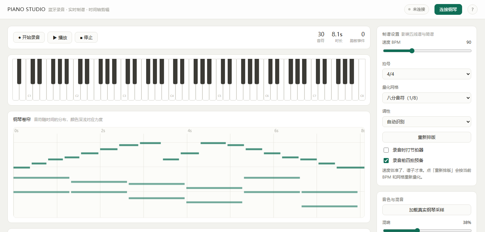
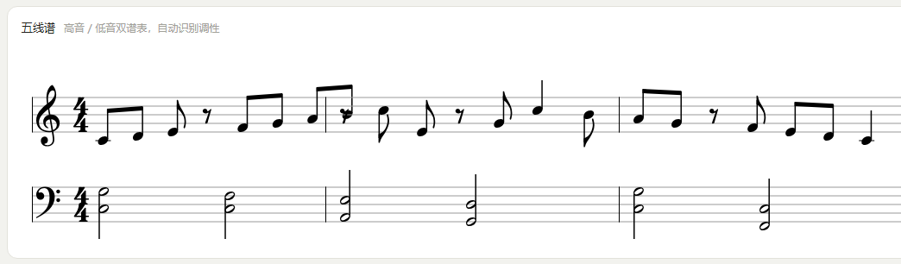
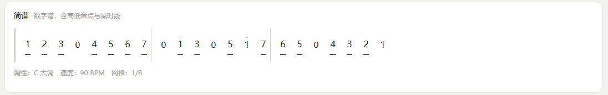
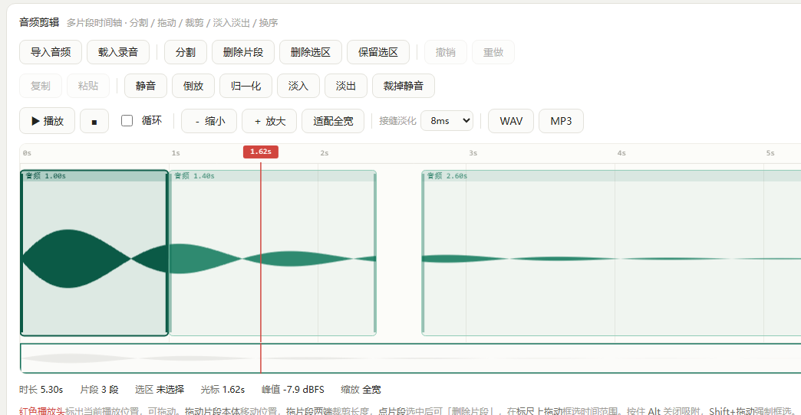
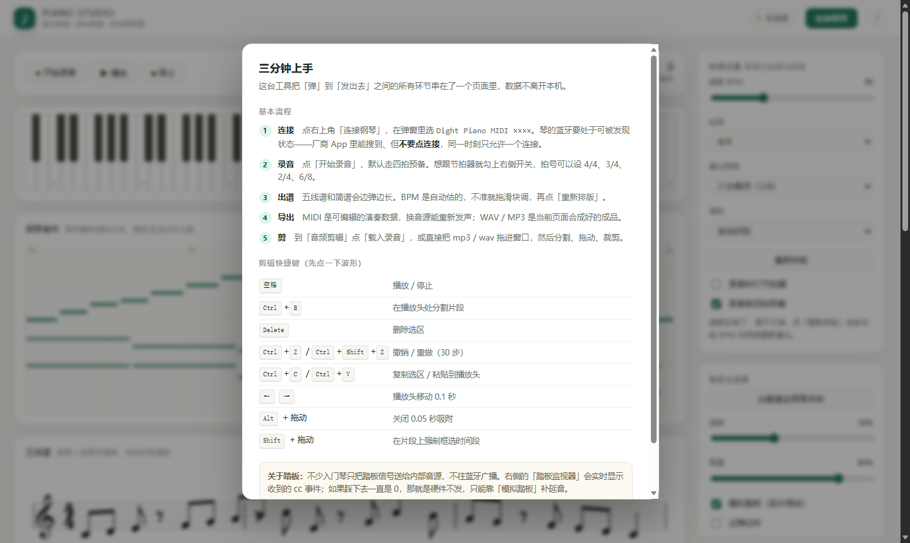

<div align="center">

# PIANO STUDIO

**离线优先的电钢琴录音、练习、制谱与音频剪辑工作台**

支持 Web Bluetooth BLE-MIDI 与 USB-MIDI，边弹边生成五线谱和简谱；
内置练习中心、标准 MIDI 导入、多片段音频时间轴、麦克风 / 声卡录音，
可导出 MIDI / WAV / MP3，以及 PNG / PDF 谱面。

浏览器直接用，也提供 Windows 桌面版；无需后端，数据保存在本机，断网也能工作。


**[在线使用](https://syh-y.github.io/piano-studio/)**  ·  **[下载 Windows 桌面版](https://github.com/SYH-y/piano-studio/releases/latest)**  ·  **[Windows 代码签名政策](docs/CODE-SIGNING-POLICY.md)**

</div>

当前版本：**v1.13.2**。功能增强记录见 [CHANGELOG.md](CHANGELOG.md)。

<details>
<summary><b>现在能做什么（点开）</b></summary>

| 环节 | 能力 |
|---|---|
| **录** | 蓝牙直连 BLE-MIDI（含踏板 CC64）；麦克风 / 声卡线路输入，带电平表、削波提示、监听与毫秒级延迟校准 |
| **谱** | 实时**五线谱**（双谱表、调号、连梁、休止符）与**简谱**（高低音点、减时线），可指定 BPM 与量化网格重排 |
| **练** | A/B 循环、40%–120% 变速、左右手声部筛选、轮次与准确率统计 |
| **编** | 卷帘里拖动改音高/时值、力度、量化、撤销重做；导入标准 MIDI 并选轨合并 |
| **剪** | 多片段时间轴：分割、拖动、裁剪、换序、留空隙、交叉淡化、归一化 |
| **出** | MIDI / WAV / MP3；五线谱、简谱导出 PNG 或打印成 PDF（可填曲名与作者） |

</details>



---

## 目录

- [它解决什么问题](#它解决什么问题)
- [功能总览](#功能总览)
- [快速开始](#快速开始)
- [五分钟上手](#五分钟上手)
- [你的琴能连吗](#你的琴能连吗)
- [技术实现](#技术实现)
- [快捷键](#快捷键)
- [已知限制](#已知限制)
- [路线图](#路线图)
- [项目结构](#项目结构)
- [开发与自检](#开发与自检)
- [许可](#许可)

---

## 它解决什么问题

想把电钢琴弹的东西留下来，通常要跨过三道坎。这个项目把三道坎都拆了。

### 坎一：录音要花钱，还有底噪

电钢琴没有"音频文件"。你按下琴键，音源实时算出波形，DAC 把它变成模拟电压送往喇叭。
想录下来，传统路径是：

```
琴的 Line Out ──模拟线──> 声卡 ──USB──> 电脑 ──> 录音软件
```

于是你会遇到：所谓"电钢琴专用内录线"卖到几百块；电平不匹配导致削波，录出来是破的；
地环路带来持续的"嗡——"；底噪无法事后消除；录坏了不能重来。

**这个项目走的是另一条路。** 中低价位的电钢琴大多内置 BLE-MIDI（蓝牙低功耗 MIDI），
它传的不是声音，而是"哪个键、按多重、什么时候抬起"。电脑直接收这些数字事件，
再在本地合成声音。整条链路没有模拟环节，所以**没有底噪、没有削波、没有地环路**。

### 坎二：想要谱子，只能手抄

弹完一段，想看看自己弹的是什么，或者发给老师、发到网上——传统做法是打开打谱软件一个个音符点进去，比自己弹一遍还慢。

这里录完就自动出谱：**五线谱**（高音/低音双谱表、调号、拍号、连梁、休止符）和**简谱**（数字、高低音点、减时线、小节线），并且支持指定 BPM 和量化网格重新排版。

### 坎三：想剪一段发出去，得再装个 DAW

录完必然要剪：掐掉开头的杂音、删掉弹错的两小节、把满意的三段拼起来、结尾淡出。
为此装一个 Audacity 或 Reaper，学习成本比弹琴本身还高。

内置的剪辑器是**多片段时间轴**模型：切一刀就变成两个独立片段，可以拖动、裁剪、换序、留空隙，
带撤销重做、零交叉对齐、峰值归一化、接缝淡化——够用，且不需要第二个软件。

### 一句话对比

| | 传统方案 | PIANO STUDIO |
|---|---|---|
| 硬件成本 | 对录线 + 声卡 ¥50–300 | **¥0**（琴自带蓝牙） |
| 音质瓶颈 | 模拟链路的底噪与削波 | 数字事件，无损耗 |
| 录坏了 | 重弹 | 改 MIDI 数据或剪音频 |
| 出谱 | 手工打谱 | 自动生成双谱表 + 简谱 |
| 剪辑 | 另装 DAW | 内置时间轴编辑器 |
| 隐私 | 上传到云端服务 | **全部在本机浏览器内** |

---

## 功能总览

### 一、录制

| 功能 | 说明 |
|---|---|
| BLE-MIDI 直连 | 走标准 GATT 服务，绕过系统配对，Windows 的"添加设备"里看不到也能连 |
| USB-MIDI | 通过 Web MIDI 连接 USB 线电钢琴，支持端口枚举与插拔监听 |
| 实时音符捕获 | 按下/抬起/力度全部记录，时间轴由本机高精度计时器打点 |
| 88 键虚拟键盘 | 随弹奏高亮，可当作可视化反馈 |
| 节拍器 | 按当前 BPM 打点，每小节首拍音高不同 |
| 四拍预备 | 录音前 `4 → 3 → 2 → 1` 倒数，让第一拍落在正确位置 |
| 踏板监视器 | 实时显示收到的 CC 事件，用来判断你的琴到底发不发踏板数据 |

### 二、制谱

| 功能 | 说明 |
|---|---|
| 五线谱 | VexFlow 排版：谱号、调号、拍号、符干方向、符尾连梁、休止符补全 |
| 简谱 | 数字谱渲染：高低音点、减时线（八分/十六分）、延音线、小节线 |
| 自动分谱表 | 以 C4 为界拆成高音/低音两个谱表 |
| 调性识别 | 基于 Krumhansl-Kessler 调性轮廓做音级直方图相关，自动匹配调号 |
| 小调识别 | 自动识别大调 / 小调，简谱显示真实调名 |
| 跨小节延音线 | 长音自动拆段，五线谱绘制 tie，简谱显示 `⌒` |
| 拍号 | 4/4、3/4、2/4、6/8，小节切分与连梁分组联动 |
| 实时刷新 | 录音过程中每 600ms 重新量化排版，谱子边弹边长 |
| 手动微调 | BPM 滑块 + 量化网格（1/4 ~ 1/16），点「重新排版」立即重算 |

钢琴卷帘支持点选、拖动改音高和时值、力度调整、移调、量化、删除，以及 50 层撤销重做。





### 三、合成与导出

| 格式 | 内容 | 用途 |
|---|---|---|
| **MIDI** | 演奏数据（含音符、力度、CC） | 导入任何音源重新发声，可继续编辑 |
| **WAV** | 44.1kHz / 16bit 无损 | 直接发布、送人、入库 |
| **MP3** | 128kbps，浏览器内用 lamejs 现编 | 文件小，方便发微信 |

MIDI 文件也可以直接导入。导入后会列出各条轨道，选择一条或多条载入钢琴卷帘，继续编辑、制谱、练习和导出。谱面支持五线谱 PNG、简谱 PNG，以及打印或保存为 PDF；导出前可以填写曲名和作者。
顶部有「演奏 / 制谱 / 剪辑 / 工程」四个工作区：演奏页保留钢琴、录音、卷帘和实时谱面；制谱页放大排版并导出 PNG / PDF；剪辑页只放时间轴；工程页放工程管理与设备诊断。
演奏页还支持选择麦克风或声卡线路输入，显示实时电平和削波状态，录音停止后自动载入剪辑器，并可用毫秒偏移做延迟校准。

音色来自本地 30 个 Salamander 三角钢琴真实录音采样（A0–C8 每 3 个半音一个，中间用变速补齐），
低音采样带二十多秒自然衰减，抬键前一直是琴弦自己在响；力度同时控制音量和高频亮度。
音源加载失败时自动退回内置合成音色，不会哑掉。混响是实时卷积生成，不加载外部脉冲文件。

### 四、音频剪辑



| 类别 | 能力 |
|---|---|
| 时间轴 | 多片段模型，片段可分割、拖动、裁剪两端、删除、留空隙，也允许片段交叠 |
| 编辑 | 删除选区 / 保留选区 / 复制 / 粘贴 / 静音 / 倒放 / 归一化 / 淡入 / 淡出 / 裁掉首尾静音 |
| 视图 | 滚轮缩放（以光标为锚点）、Shift 平移、时间标尺、全局概览条、播放头跟随 |
| 精度 | 0.05 秒吸附（Alt 关闭）、零交叉对齐、选区时长气泡 |
| 历史 | 补丁式撤销/重做 30 步（只记录被改动的采样区间，不整份复制音频） |
| 接缝 | 片段首尾 8 / 30 / 80ms 线性淡化，消除硬切的"咔"声 |
| 交叉淡化 | 重叠片段按重叠时长自动淡出 / 淡入 |
| 导入 | 按钮选择、**直接拖拽文件到窗口任意位置**、或一键载入本次录音 |

### 五、工程管理

| 功能 | 说明 |
|---|---|
| 自动保存 | 每次编辑后 1.2 秒写入元数据；音频仅在内容变化时重新编码，关标签页有兜底 |
| 崩溃恢复 | 重新打开时提示「发现上次的工作：N 段音频、M 个音符」 |
| 工程文件 | 导出 `.json`（含音频与全部编辑状态），可备份、换设备、直接拖进页面打开 |
| 版本快照 | 保存、恢复、删除多个历史版本；录音完成后自动保存一个版本 |

---

## 快速开始

### 方式一：桌面版（推荐，Windows）

到 [Releases](https://github.com/SYH-y/piano-studio/releases/latest) 下载：

- **`PianoStudio-Setup-x.y.z.exe`** — 安装版，双击安装，桌面快捷方式
- **`PianoStudio-Portable-x.y.z.exe`** — 免安装绿色版，下载后直接双击

自带 Chromium，不需要装 Python、不需要浏览器，蓝牙功能完整。
安装包未做代码签名，SmartScreen 提示时选「更多信息 → 仍要运行」。

### 方式二：网页版（Windows / macOS / Linux）

#### Windows

1. 装 [Python 3](https://www.python.org/downloads/)（安装第一步勾选 `Add python.exe to PATH`）
2. 双击 **`start.bat`**
3. 浏览器自动打开，用 **Chrome 或 Edge**

### macOS / Linux

```bash
./start.sh
# 或者
python3 serve.py
```

### 手动起服务

```bash
python serve.py               # 自动选端口并打开浏览器
python serve.py 9000          # 指定端口
python serve.py --no-browser  # 只起服务
```

### 为什么不能直接双击 index.html

Web Bluetooth 属于**强安全上下文** API，浏览器只允许在 `https://` 或 `http://localhost` 下调用。
`file://` 协议会直接被拒绝——连设备选择框都不会弹出来。

所以需要 `serve.py` 起一个本地 HTTP 服务。它只监听 `127.0.0.1`，不对外网开放，
不发任何请求到互联网，作用仅仅是把文件通过 localhost 递给浏览器。

> 端口 8765 被占用时会自动顺延到 8766、8767……
>
> 如果你只想看界面或者剪一段现成的音频（完全不用蓝牙），也可以直接双击
> `index.html`——其余功能正常，只有「连接钢琴」会失效。

### 浏览器支持

| 浏览器 | 状态 |
|---|---|
| Chrome / Edge 89+（桌面） | ✅ 完整支持 |
| Chrome for Android | ⚠️ 支持蓝牙，窄屏布局已适配；复杂剪辑建议横屏或桌面端 |
| Firefox | ❌ 不支持 Web Bluetooth |
| Safari（macOS / iOS） | ❌ 不支持 Web Bluetooth |

详细设备验证方法见 [兼容性矩阵](docs/COMPATIBILITY.md)，发布前检查项见 [发布检查清单](docs/RELEASE-CHECKLIST.md)。

---

## 部署成在线演示（可选）

项目是纯静态的，没有后端，所以随便找个静态托管就能跑起来：

**GitHub Pages**

1. 仓库 **Settings → Pages**
2. Source 选 `Deploy from a branch`，分支 `main`，目录 `/ (root)`
3. 保存，等一两分钟，访问 `https://<用户名>.github.io/<仓库名>/`

Pages 提供的是 `https://`，本身就是安全上下文，**在线版和本地版功能完全一样**，
Web Bluetooth 可以直接用。

**其他平台**：Netlify、Cloudflare Pages、Vercel 直接拖整个目录即可，
不需要任何构建命令。

---

## 五分钟上手

**1. 连接**

点右上角「连接钢琴」，在弹窗里选名字里带 `Piano` 的设备（例如 `Dight Piano MIDI 2338`）。

琴的蓝牙要处于**可被发现**状态。如果你的琴有厂商 App，在 App 里让它搜到设备、
停在"未连接"那一页就行——**不要点连接**，BLE 设备同一时刻只允许一个连接。

**2. 录音**

点「开始录音」，默认走四拍预备。想跟节拍器就勾上「录音时打节拍器」，
拍号在右侧设置里选。

**3. 出谱**

五线谱和简谱会随着弹奏实时刷新。如果排得乱，多半是 BPM 估得不准：
拖速度滑块调到你实际弹的速度，再点「重新排版」。

**4. 导出**

- 只想留个记录、以后还想改 → **MIDI**
- 想直接发出去 → **WAV** 或 **MP3**

**5. 剪辑**

到「音频剪辑」点「载入录音」，或者把 `piano_xxx.mp3` 直接从文件夹拖进页面。
按住片段拖动可以换位置，拖片段两端可以裁长度，把播放头放好点「分割」可以切两半。

**6. 不弹也能看**

访问 `index.html?demo=1` 会载入一段示例（右手音阶 + 左手和弦），
三个视图和剪辑器都有内容，用来先熟悉界面。

---

## 你的琴能连吗

这个项目只对**标准 BLE-MIDI 设备**有效。判断方法按可靠程度排序：

### 方法一：查蓝牙广播（最准）

在电脑上扫描附近的 BLE 广播，看有没有设备的 Service UUID 是：

```
03b80e5a-ede8-4b33-a751-6ce34ec4c700
```

这是蓝牙 MIDI 的国际标准服务 UUID。有，就能连。

### 方法二：看厂商 App

如果厂商 App 里有一个叫「蓝牙 MIDI 设备」之类的页面，写着"输入/输出"，
那基本可以确定它暴露了 BLE-MIDI。

### 方法三：直接试

打开本工具点「连接钢琴」，弹窗里能看到设备名就能连。

### 如果连不上

| 现象 | 含义 | 怎么办 |
|---|---|---|
| 弹窗里根本没有你的琴 | 不是 BLE-MIDI，或蓝牙没开 | 走模拟内录 |
| 有设备但连上后没数据 | MIDI 通道被私有协议锁了 | 需要逆向厂商 App，本项目未覆盖 |
| 能弹但踏板没反应 | 琴只把踏板送给内部音源 | 硬件限制，用「模拟踏板」补延音 |

**不是 BLE-MIDI 也不代表这个工具没用了。** 你仍然可以用
「对录线 + USB 声卡」录成 wav/mp3，然后把文件拖进剪辑器——
制谱之外的其余功能照常可用。

> 顺带说一个常见误区：机体上的 **USB-A 扁口**（标着 `USB` / `U DISK`）是主机口，
> 用来读 U 盘，**不能**和电脑通信。能连电脑的是方口 USB-B（`USB TO HOST`）或蓝牙。
> 两头都是主机口的线接起来，USB 枚举永远不会发生。

---

## 技术实现

### 蓝牙链路

```
电钢琴 ──BLE GATT──> 浏览器 Web Bluetooth ──> 页面
         Service 03b80e5a-…-6ce34ec4c700
         Characteristic 7772e5db-…-f2669d106bf3  [notify, write, read]
```

不走系统配对，直接 `navigator.bluetooth.requestDevice()` →
`device.gatt.connect()` → `startNotifications()`。这也解释了为什么
Windows 的「添加设备」里看不到它：那个界面只显示带标准配置文件
（耳机、键盘、音箱）的设备，而 BLE-MIDI 不属于任何"外设类别"。

### BLE-MIDI 报文解析

一个通知包（BEP）的真实结构是：

```
[包头 0x80|ts高6位]  ( [ts低7位] [状态字节] [数据...] )*
```

包头携带 13 位毫秒时间戳的**高 6 位**，每条消息前各带一个**低 7 位**的时间戳字节。
时间戳字节可以省略，表示沿用上一个。

麻烦的是：时间戳字节（`0x80–0xFF`）和状态字节（`0x80–0xEF`）、
系统实时消息（`0xF8–0xFF`）的取值范围**完全重叠**。裁决规则只有一条：

> **时间戳后面一定跟状态字节（≥0x80）；状态字节后面一定是数据字节（<0x80）。**

所以看一眼下一个字节就能定，不需要猜：

```js
var next = buf[i + 1];
if (next === undefined) { carry = buf.slice(i); break; }  // 判别不了，留到下一包

if (next >= 0x80) {                    // 后面还是高位字节 → 这是时间戳
  var raw = (hi6 << 7) | (b & 0x7F);
  if (lastRaw >= 0 && raw < lastRaw && lastRaw - raw > 4096) wrapBase += 8192;
  ts = wrapBase + raw;
  i++;
  continue;
}

// 否则是状态字节
var n = (b === 0xC0 || b === 0xD0) ? 1 : 2;   // 音色切换/通道压力只有 1 个数据字节
if (i + n >= buf.length) { carry = buf.slice(i); break; }
out.push({ ts: ts, msg: buf.slice(i, i + n + 1) });
i += n + 1;
```

三个细节：

- **13 位时间戳会回绕**（8192ms 一轮）。不解回绕的话，8 秒后所有时间戳突然归零，
  音符全挤到开头。用 `lastRaw - raw > 4096` 区分回绕与乱序。
- **包尾歧义要暂存**。最后一个字节无法判别时留在 `carry` 里，与下一包拼接后再解。
- **实时消息单独处理**。`0xF8` 没有数据段，放进正常流程会被误认为状态字节。

### 时间基准：包间用本机钟，包内用设备钟

BLE 通知是打包发送的，一串和弦可能挤在同一个包里到达。如果一律按到达时刻打点，
这些音会全部落在同一毫秒；而完全信设备时钟，录几分钟又会因为晶振漂移跑偏。

所以在录音侧做混合：

```js
var base = list[0].ts;                       // 本包第一条的时间戳
var off = list[i].ts - base;                 // 包内偏移（0~几十 ms）
handleMessage(list[i].msg, arrival + off);   // 到达时刻 + 包内偏移
```

设备时间戳恒定时（有些琴的 ts 字段永远是 0），偏移恒为 0，自动退回到达时刻——
所以这个改动不会影响原本能用的设备。

### 制谱流水线

```
音符事件
  ├─ 1. 估计 BPM      取音符间隔的中位数反推，录音时每 2.5s 重估一次
  ├─ 2. 检测调性      12 个音级加权直方图 × Krumhansl-Kessler 大调轮廓，取相关最大
  ├─ 3. 量化          按网格（1/4 ~ 1/16）对齐到拍点，同拍音符合并成和弦
  ├─ 4. 切小节        按拍号算小节长度，补全休止符，超出的音符截断
  ├─ 5. 分谱表        pitch < 60 进低音谱表，其余进高音谱表
  ├─ 6. 拼 VexFlow    每行 3 小节，自动加谱号/调号/拍号，generateBeams 连梁
  └─ 7. 简谱         另一套渲染：数字 + 八度点 + 减时线 + 小节线
```

调性识别用的是 Krumhansl-Kessler 大调轮廓
`[6.35, 2.23, 3.48, 2.33, 4.38, 4.09, 2.52, 5.19, 2.39, 3.66, 2.29, 2.88]`，
把音级直方图依次旋转 12 个主音位置算加权和，取最大值。

### 音频引擎

- **采样播放**：`AudioBufferSourceNode` + `playbackRate` 变速，30 个采样覆盖 A0–C8
- **力度响应**：音量按力度指数缩放，同时用低通把弱奏的高频压暗（单层采样模拟力度分层）
- **混响**：用低频衰减的噪声加早期反射实时生成脉冲响应，喂给 `ConvolverNode`，不依赖外部 IR 文件
- **限幅**：总线末端挂一个 `DynamicsCompressorNode`，防止和弦叠加时削波
- **离线渲染**：导出时用 `OfflineAudioContext` 比实时快得多地算完整段

### 剪辑器的数据模型

不是"一整块音频"，而是**源缓冲 + 片段列表**：

```
源缓冲（一条 AudioBuffer）
  ├─ 片段 A：srcStart=0.0, srcEnd=1.0, start=0.0,  gain=1
  ├─ 片段 B：srcStart=1.0, srcEnd=2.4, start=1.0,  gain=1
  └─ 片段 C：srcStart=2.4, srcEnd=5.0, start=2.7,  gain=1
                                    ↑ 这里留了 0.3s 空隙
```

所有操作都只改片段元数据，不搬动采样数据，所以分割、拖动、换序都是 O(1) 级别。

**补丁式撤销**：一次操作记为 `{ 片段快照, [改动区间: 改前数据 / 改后数据] }`。
原来每次淡入/归一化都要整份复制音频（10 分钟曲子约 100MB/次 ×6 层），
现在改 0.3 秒一段只占几十 KB，所以深度从 6 层提到 30 层。

**峰值金字塔**：按 128 采样一桶预计算 min/max，缩放时只聚合桶，
复杂度从"每个像素扫一遍全部采样"降到约 1/130。

**粘贴即复制**：粘贴时把数据写到源缓冲末尾，新片段指向新地址，
两个片段物理隔离——代价是缓冲会扩容一次。

### 持久化

音频动辄几 MB，`localStorage` 的 5MB 上限装不下，所以用 **IndexedDB**：

| 键 | 内容 |
|---|---|
| `meta` | 片段结构、音符、BPM、拍号、网格、调性 |
| `audio` | 16bit WAV（比 Float32 省一半，且能直接被 `decodeAudioData` 读回）|

素材没有内容时只存几 KB 的元数据。

---

## 快捷键

先点一下波形让它获得焦点。

| 键 | 作用 |
|---|---|
| `空格` | 播放 / 停止 |
| `Ctrl` + `B` | 在播放头处分割片段 |
| `Delete` | 删除选区 |
| `Ctrl` + `Z` / `Ctrl` + `Shift` + `Z` | 撤销 / 重做 |
| `Ctrl` + `C` / `Ctrl` + `V` | 复制选区 / 粘贴到播放头 |
| `←` `→` | 播放头移动 0.1 秒 |
| `Alt` + 拖动 | 关闭 0.05 秒吸附 |
| `Shift` + 拖动 | 在片段上强制框选时间段 |

页面右上角的 `?` 里也有一份，忘了可以随时点开。



---

## 已知限制

这些是当前版本的边界。它们不影响录音、编辑、制谱和导出主流程，但会影响更复杂的练习与制谱场景。

| 限制 | 原因 | 影响 |
|---|---|---|
| 踏板数据可能收不到 | 不少琴只把踏板信号送给内部音源，不往蓝牙广播 | 用「模拟踏板」补延音，但拿不到真实的半踩/换踩 |
| 三连音 | 当前没有可靠的自动识别策略 | 三连音需要手动修正或后续专门建模 |
| 音色是单层采样 | 30 个采样没有力度分层 | 弱奏用低通压暗高频来近似，强弱的泛音变化不如真琴细 |
| 拍号是全局固定值 | 不支持曲中变拍号 | 变拍子的曲子排版会错 |
| 简谱两行不严格纵向对齐 | 高低音各自按拍位顺序排布 | 能看，但不是总谱式的严格对齐 |
| 波形计算未移入 Worker | 峰值金字塔已经把缩放降到约 1/128 | 极长音频仍可能占用主线程 |
| 触控拖动 | 移动端按钮和滚动已适配，画布使用 Pointer Events | 低端设备的大文件拖动仍需实机观察 |
| 自动快照数量 | 默认只保留最近 20 个版本 | 更早版本会被自动清理 |
| 粘贴会扩容缓冲 | 独立性换内存 | 粘得越多占用越大 |

---

## 路线图

按价值排序，不代表时间承诺。

- [x] **练习中心（基础版）**——A/B 循环、分段练习、渐进速度、左右手分离、错音与节奏反馈、练习记录；高级评分模型仍待完善
- [x] **MIDI 工作流（基础版）**——导入 MIDI、轨道/声部管理、踏板与控制器编辑；导出后回放校验仍待完善
- [x] **谱面输出（基础版）**——PDF / PNG / 打印；手动调号与变拍号、三连音、标题与和弦标注仍待完善
- [x] **设备诊断（基础版）**——BLE-MIDI / USB-MIDI 检测、延迟测试、权限和端口故障提示；更多型号验证仍待完善
- [x] **音频输入（基础版）**——麦克风或线路录音、输入增益、削波提示、输出设备和延迟校准；更多声卡兼容性仍待验证
- [x] **桌面发行**——Windows 安装版 + 绿色版，内置自动更新（v1.9.0 起）
- [ ] **桌面发行（续）**——代码签名、版本回滚、macOS / Linux 构建
- [ ] **性能与数据安全**——采样缓存、长音频 Worker、存储配额提示、多标签页冲突恢复
- [x] **PWA 离线安装**——Service Worker 已加入
- [x] **Windows 桌面版**——Electron 安装版和免安装版已接入构建流程

---

## 项目结构

```
piano-studio/
├── index.html              页面结构
├── styles.css              页面样式与响应式布局
├── app.js                  录音、制谱、剪辑与工程逻辑
├── manifest.webmanifest    PWA 安装清单
├── sw.js                   离线缓存 Service Worker
├── icon.png                应用图标原图（1254×1254，桌面 exe 由它生成）
├── icon-64.png             浏览器标签页图标（5 KB）
├── icon-180.png            iOS 添加到主屏幕
├── icon-192.png / 512.png  PWA 安装图标
├── icon.svg                旧版矢量图标（保留备查）
├── serve.py                本地静态服务器（Web Bluetooth 需要安全上下文）
├── start.bat               Windows 一键启动
├── start.sh                macOS / Linux 一键启动
├── lib/
│   ├── vexflow.js          VexFlow 4.2.3，五线谱排版
│   ├── vexflow-bravura.js  Bravura 音乐字体数据
│   └── lame.min.js         lamejs 1.2.1，浏览器内 MP3 编码
├── samples/                30 个钢琴采样（A0–C8，每 3 个半音一个）
├── desktop/                Electron 桌面版外壳（main.js + 打包配置）
├── docs/                   README 用的截图
├── THIRD-PARTY-NOTICES.md  第三方许可与署名
├── CHANGELOG.md
└── LICENSE
```

没有构建步骤，没有运行时依赖安装。改完 `index.html`、`styles.css` 或 `app.js` 后刷新浏览器即可。

---

## 开发与自检

页面内置一套断言，不需要任何测试框架：

```
http://localhost:8765/index.html?selftest=1
```

会在页面左上角打印 **93 条断言**，覆盖片段分割/合并、删除后贴合、越界钳制、
撤销重做、粘贴独立性、工程序列化、拖拽文件识别、裁剪静音不丢片段、
附点时值、调号拼写、BLE-MIDI 报文解析等。

其他调试参数：

| 参数 | 作用 |
|---|---|
| `?demo=1` | 载入示例演奏（右手音阶 + 左手和弦） |
| `?selftest=1` | 运行 93 条内置断言 |
| `?help=1` | 直接打开帮助面板 |
| `?nohelp=1` | 抑制首次访问的帮助弹窗（截图用） |
| `?idbtest=1` | 检查 IndexedDB 是否可读写 |

**它不吃你的隐私**：没有后端、没有埋点、没有任何网络请求
（除了你自己拖进来的文件）。断网也能完整使用。

---

## 许可

- 源代码：**MIT**，见 [LICENSE](LICENSE)
- `lib/` 与 `samples/` 中的第三方资源另有许可，见 [THIRD-PARTY-NOTICES.md](THIRD-PARTY-NOTICES.md)

其中钢琴采样来自 **Salamander Grand Piano**（Alexander Holm 录制），采用 **CC BY 3.0**，
如需再分发请保留署名。

---

## 致谢

- [VexFlow](https://github.com/0xfe/vexflow) —— 没有它就没有像样的五线谱
- [lamejs](https://github.com/zhuker/lamejs) —— 纯 JS 的 MP3 编码器
- [midi-js-soundfonts](https://github.com/gleitz/midi-js-soundfonts) —— 早期版本使用的 FluidR3_GM 采样
- [Salamander Grand Piano](https://archive.org/details/SalamanderGrandPianoV3) —— 现在的钢琴采样（Alexander Holm 录制）
- [Web Bluetooth](https://developer.mozilla.org/docs/Web/API/Web_Bluetooth_API) 与
  [BLE-MIDI 规范](https://midi.org/midi-over-bluetooth-low-energy) —— 让浏览器能直接和琴说话

---

<div align="center">

如果这个工具帮你省下了一根内录线的钱，欢迎点个 ⭐

</div>
